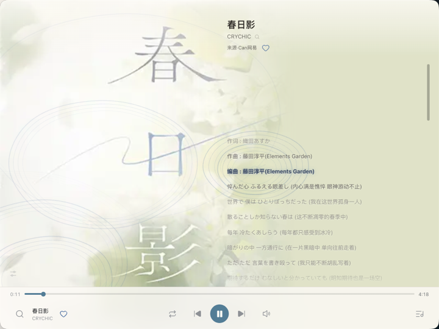
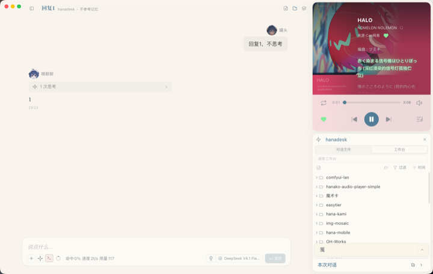
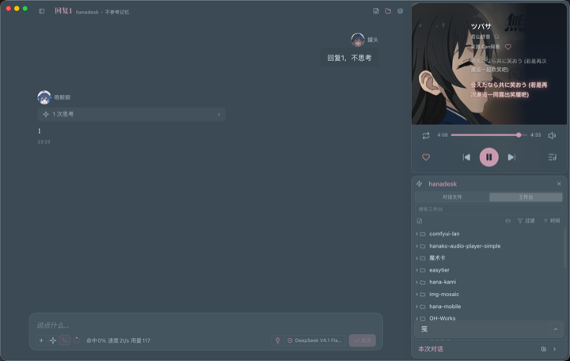
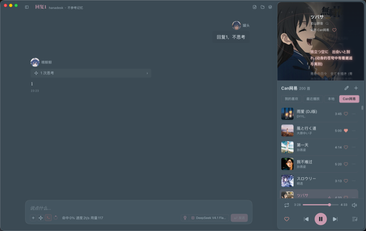
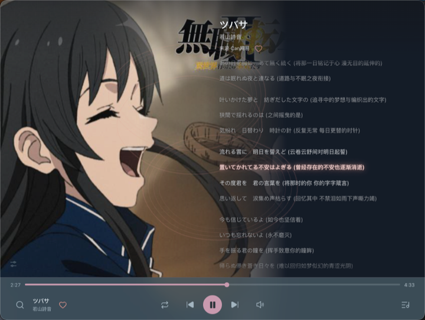
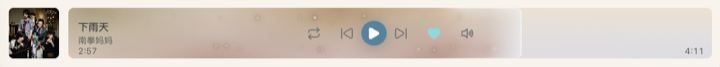

# 小花音乐播放器（hanako-simple-player）

**四源开箱即用的本地与在线音乐播放器，为 Hana 而生。**
网易云 / B站 / QQ / 酷狗直接能搜能听，B站还能抽视频音轨直接播；歌词自动匹配、当前行推上会话横幅；
唱片封面会随音乐荡开涟漪——低音是向上涌动的水面光波，鼓点是等高线圈，镲片是轻细的小环，
独立窗左下角可分别调三组触发门槛与颜色浓淡，默认克制、随你调；四种承载形态（窄长卡 / 矮卡 / 独立窗 / 横条）各自重排，
主题只跟随宿主 `hana.theme`（含夜间）。把窗拉扁就成一条**横条**：封面氛围取色的长条进度 + 进度前沿的玻璃光片与流动星光。

**递给 Hana 的那部分**：敲 `/mood` 让它按心情选歌建单，也能让它把 B站歌单整理成带网易云歌词与封面的歌单。

> 基于 [openhanako-labs/openhanako-audio-player](https://github.com/openhanako-labs/openhanako-audio-player)（作者 **Yuexiye**）的**极简重构衍生版**：
> 后端沿用上游，前端整个重写、按 Hana 的承载形态重新设计。
> 上游以 **AGPL-3.0** 发布（另提供[商业授权](https://github.com/openhanako-labs/openhanako-audio-player/blob/master/COMMERCIAL-LICENSE.md)），
> 本衍生同样以 **AGPL-3.0** 发布，见 [`LICENSE`](LICENSE)。

自有图标与名称，包 id 为 `hanako-simple-player`，**与上游 `hanako-audio-player` 不同名，可同时安装**。

## 截图

> 点任意缩略图看原图。这里展示的是它在 Hana 承载形态下的实际样子（浅色 / 深色主题都跟随宿主）。

<table>
<tr>
<td width="50%" align="center">
<a href="docs/showcase/01-window-light-lyrics.png"></a>
<br><sub><b>独立窗口</b> · 浅色 · 歌词态</sub>
</td>
<td width="50%" align="center">
<a href="docs/showcase/02-card-light-lyrics.png"></a>
<br><sub><b>聊天卡片</b> · 浅色 · 歌词态（嵌在 Hana 侧栏）</sub>
</td>
</tr>
<tr>
<td width="50%" align="center">
<a href="docs/showcase/03-card-square-dark.png"></a>
<br><sub><b>嵌入式方卡</b> · 深色</sub>
</td>
<td width="50%" align="center">
<a href="docs/showcase/04-card-long-dark.png"></a>
<br><sub><b>嵌入长条卡</b> · 深色 · 歌单（上方舞台 + 下方列表）</sub>
</td>
</tr>
<tr>
<td width="50%" align="center">
<a href="docs/showcase/05-frosted-controls.png"></a>
<br><sub><b>毛玻璃控制栏</b> · 独立窗半透明</sub>
</td>
<td width="50%" align="center">
<a href="docs/showcase/06-immersive-dark.png"></a>
<br><sub><b>沉浸式大卡</b> · 歌词全屏</sub>
</td>
</tr>
<tr>
<td colspan="2" align="center">
<a href="docs/showcase/07-touchbar-dark.png"></a>
<br><sub><b>横条形态</b> · 深色主题 · 歌词态（把窗拉扁后的第四种呈现）</sub>
</td>
</tr>
<tr>
<td colspan="2" align="center">
<a href="docs/showcase/08-touchbar-light.png"></a>
<br><sub><b>横条形态</b> · 浅色主题 · 控件态</sub>
</td>
</tr>
</table>

## 特色

**能把网易云、QQ、B站 的歌收进收藏。** 搜到就能点进「我的喜欢」。
B 站是别的音乐播放器少有的源：搜到视频、抽它的音轨直接播，**不用 cookie**；
网易云填一次 cookie 听完整版。QQ / 酷狗也能搜到、能收藏，但公共节点通常只出试听，
完整播放需配自己的 cookie（见「可选：完整音源」）。

**会跟着你的 Hana 变样子。** 主题不另起一套，只跟随宿主 `hana.theme`：换主题、切夜间，它跟着走。

**封面之上有一片会呼吸的水面。** 指针划过激起涟漪，音乐一响，鼓点会真的推起波纹
（低频能量驱动；跨源曲目自动退回纯指针涟漪，绝不静音）。

**为 Hana 的每种窗口而生。** 聊天卡片（窄长 / 矮卡）、独立窗口各自重排；
窄到 400px 会把模式与音量上移一行，**播放键永远在正中**。

**开源、开箱即用、可自建。** 四个公开音源内置，装上就能搜能听；
想听完整版，填一次自己的 cookie 即可（见「可选：完整音源」）。

**首开就有歌听。** 空安装首次打开会预置一首欢迎曲（有封面有歌词），点播放键即响；
想看它怎么用，「＋ 在哪」也在欢迎卡里一并告诉你。

## 和其他版本的区别

| | 原版（Yuexiye） | 小花版 |
|---|---|---|
| 前端 | `ui/index.html` 单文件（约 734 KB） | 拆成 `index.html` + `app.js` + `style.css`，状态由 `data-*` 驱动，无构建 |
| 视觉 | 三模式胶囊：标准（黑胶唱盘）/ PV（文字排版舞台）/ 歌词 | 单一形态、按承载自适应：窄长卡 / 矮卡 / 宽窗 |
| 主题 | 内置配色面板 + 多套预设 | 只跟随宿主 `hana.theme`（含夜间），不自带面板 |
| 动效 | 黑胶旋转、PV 逐字扫光 | 指针涟漪（真音频驱动的「流光」水面）+ 响应式歌词连续波浪 |
| 音源 | 网易云 / QQ / 酷狗 | 网易云 / **B站** / QQ / 酷狗 |
| 构建 | `pv/build.mjs` 幂等流水线 + `pv/release.mjs` 出双包 | 无构建；`tools/bump-build.mjs` 只管构建号 |
| 取源 | `music/go/:id` 302 跳 CDN | **同源分片流式代理**（跨源媒体接 Web Audio 会被静音） |

## 功能

**播放**
- 本地文件 / 文件夹扫描导入（`.mp3` `.wav` `.ogg` `.flac` `.m4a`），走 Range 流式，拖进度条不卡
- 在线曲目走 meting 公共节点（多节点自动降级）；粘贴链接可导入**整张歌单**或**单曲**
- 播放列表：本地固定文件夹 + 自建导入列表，可切换 / 重命名 / 删除；去重键带上归属，同一首歌可同时存在于多个歌单
- 补全歌手（老数据缺 author 时按标题回查）

**搜索（内置公开音源）**
- 四个音源开箱即用：**网易云 / B站 / QQ / 酷狗**，不用配置
- 搜歌曲 / 搜歌手两种范围；点搜索结果行**直接播放**，播过自动进「最近播放」
- 结果行尾红心 = 收藏进「我的喜欢」（**收藏与播放是两件事**）
- 空白时预置推荐：热门歌曲 / 榜单歌单 / 热门电台

**B站音轨**（原版没有）
- 搜 B 站视频、抽其音频轨播放，也能**收进「我的喜欢」**；粘贴 B站链接可直接导入
- **多 P 视频展开分集**：一条视频塞了多个分 P 时，点开可看分集列表（分 P 名当歌名），
  子行单独收藏，或「导入成歌单」整条导进来
- **合集封面补全**：B站曲目常缺封面，队列头部「＋」→「补全封面…」按歌手从网易云官方
  元数据回填（标题精确匹配；恢复原封面随时可退，重载后仍可恢复）
- 登录 B站可解锁 **Hi-Res FLAC / 杜比全景声**
- 代价：B站曲目**没有 LRC 歌词**（退回无歌词态，画面走封面 + 涟漪）

**歌单**
- 歌单内可**搜索筛选**；新加入的曲目**置顶**显示
- 队列行右键/长按：「移动到…」其他歌单、复制歌名
- 歌单多时切换条两侧按需渐隐（提示「后面还有」），并自动把当前项滚进视野

**歌词**
- 播放即按曲名自动匹配，多源回退（TTML / LRC）；匹配过的歌词自动落盘（`app-data/lyrics/`），离线也能出词
- **响应式字号与行数**：按真实阅读区宽高计算，目标行数大卡 10 / 长卡 6 / 方卡 5（软约束，空间不足优先保可读字号）
- **连续波浪**：整句播放期间，当前句与上下句以波峰连续放大回落，换句处位置与速度连续、无突然跳动；浮点波峰由媒体时钟驱动，暂停保留相位、继续接着走
- 匹配错了可**挑可换**：无词时歌词区中央给入口；长按歌词拖动可对齐节奏，偏移按曲保存
- 手动匹配会**列出候选让人挑**（歌名 + 歌手 + 平台），点哪条绑哪条，绑定写入曲目、重载不丢
- 手动滚动不抢滚动，停止约 3 秒后平滑回归；长标题单行省略、悬停看全名
- 无 LRC 时退回无歌词态（画面走封面 + 涟漪）
- 歌词横幅：当前行实时推到会话输入框上方

**视觉**
- 封面主色调背景 + 歌词两态薄纱；当前句高亮（颜色 + 字重）
- **指针涟漪**：封面之上的 Canvas 2D「流光」水面；接真音频（`captureStream` + `AnalyserNode`）随鼓点起波——
  低频推起宽缓水面、中高频（军鼓 / 钢琴 / 踩镲）触发短波，跨源时自动退回纯指针涟漪，**绝不静音**
- **涟漪参数面板**（宽窗左下角）：可调整体强度 / 低频推动 / 敲击与中高频灵敏度 / 同时波纹数 / 落波间隔，调完自动记住
- 动效底线：**可打断**，只动 `transform` / `opacity`；reduced-motion 退为纯淡入

**适配 Hana 的多种承载**
- 聊天卡片（窄长卡 / 矮卡）与独立窗口各自重排；控制面按宽度自适应（窄到 400px 模式与音量上移一行，**播放键恒居中**）
- **横条形态**：窗口/卡片被压到宽而矮时自动切换——左侧小封面，右侧一条用封面主色氛围取色的长条进度，
  条内显示歌名/歌手与正在唱的歌词；指针靠近切控件与时间，悬停音量向右展开。进度前沿有玻璃光片与向左流动的星光。

## 安装

**推荐：装 release 包**（不用 clone 源码，也不用碰打包工具链）

1. 到 [Releases](https://github.com/wqh0201-stack/hanako-simple-player/releases) 下载
   `app-hanako-simple-player-<版本>.zip`（连同同名 `.entry.json`）；
2. 让 Hana 安装这个 zip（本地来源安装），审批它声明的 5 项能力；
3. 装完在应用详情页即可 Reload。

> release zip 是**运行时文件**打的包（约 0.5MB），不含 `docs/` 设计与交接文档、`tools/` 验证脚本。

**从源码装**（改代码、参与开发时）

1. 把源码目录放到 `<HANA_HOME>/apps/` 下，**目录名必须等于 `manifest.id`**，即 `hanako-simple-player`
   （GitHub 直接下载的 zip 解压出来名字不对，**必须重命名**，否则官方校验器直接拒绝）；
2. 打包或直接安装都需要官方工具链，先设环境变量：
   `HANA_APP_TOOLS_ROOT=<HANA_HOME>/artifacts/server/<版本>`（该目录里有 `APPS.md` 与 `scripts/`）；
3. 让 Hana 以**本地来源**安装（目录或 `tools/pack-release.mjs` 产出的 zip），审批能力；
4. 之后改代码：同步 `ui/` + Reload 即可。

最低 Hana 版本：`0.1017.0`。

## 可选：完整音源

播放器**开箱即用**（内置公共 Meting 节点 + 各平台官方接口），不填 cookie 也能搜能听，
代价是**部分歌只能听到试听版**。想解锁完整音频，在 `app-data/hanako-simple-player/cookies.env`
里填一次登录 cookie：

```
NETEASE_COOKIE=MUSIC_U=xxx; __csrf=xxx; ...
TENCENT_COOKIE=uin=xxx; qqmusic_key=xxx; ...
```

怎么拿到 `MUSIC_U` / `__csrf` 这些值：**问你自己的 Hana**（它能带你从浏览器开发者工具里
拿到），或参考上游仓库关于 cookie 的说明。填完 Reload 即可生效。

> 首次打开播放器时会弹一次这个提示，知道后不会再打扰。

## 开发

```
ui/index.html            卡片页
ui/standalone.html       独立窗页（内容与 index.html 相同，仅 data-shell 不同）
ui/app.js                全部逻辑（ES5，无构建）
ui/style.css             全部样式（多态布局 + 动效）
tools/bump-build.mjs     构建号三处同步（_build.json + index.html + standalone.html）
tools/pack-release.mjs   出 release 包：白名单复制运行时文件 → 官方 extension-pack
tools/verify-ui.mjs      无头验收：布局自检 + 断言 + 截图
tools/verify-backend.mjs 后端验收：去重键 / DELETE / playback-state / playlist-meta
```

**两条铁律**
- `ui/index.html` 与 `ui/standalone.html` 必须同步改（只差 body 的 `data-shell`），改完跑 `node tools/bump-build.mjs`
- 无构建步骤：改完 **`ui/` 整包同步**（index / standalone / **style.css** / _build.json）进安装目录 + Reload 即可

## 许可

**AGPL-3.0**，见 [`LICENSE`](LICENSE)。本仓库是上游 AGPL-3.0 作品的衍生，因此同样以 AGPL-3.0 分发。
若需闭源或商业使用，请走上游的[商业授权](https://github.com/openhanako-labs/openhanako-audio-player/blob/master/COMMERCIAL-LICENSE.md)。

## 致谢

- **Yuexiye** —— 原版 [openhanako-audio-player](https://github.com/openhanako-labs/openhanako-audio-player) 的作者，本项目的后端与数据链路全部来自其作品
- [AMLL TTML DB](https://github.com/Steve-xmh/amll-ttml-db) —— 逐字歌词数据库
- Meting 公共节点 —— 搜索 / 歌词 / 直链
- 上游原版 PV 的灵感来源（本版未采用，一并致意）：JIZURA（852話）文字 PV 排版引擎、folia-major Monet 动效公式
