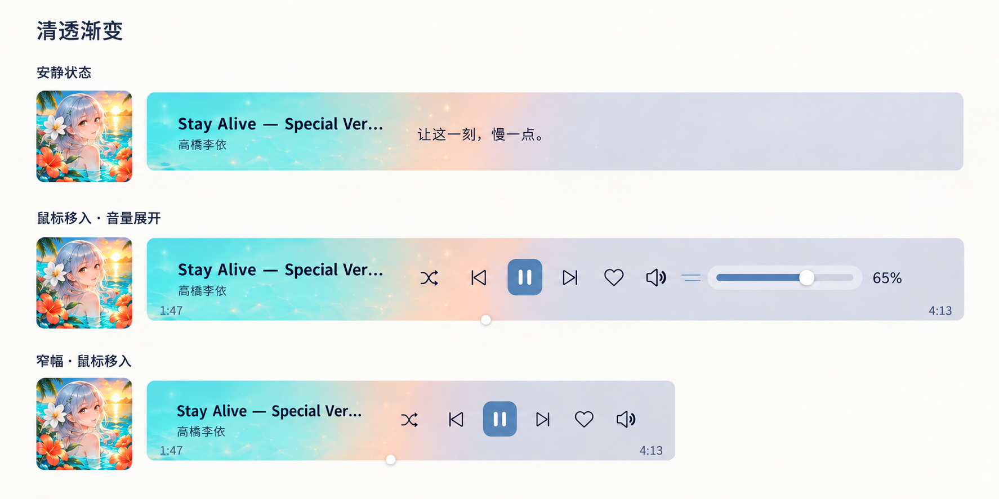
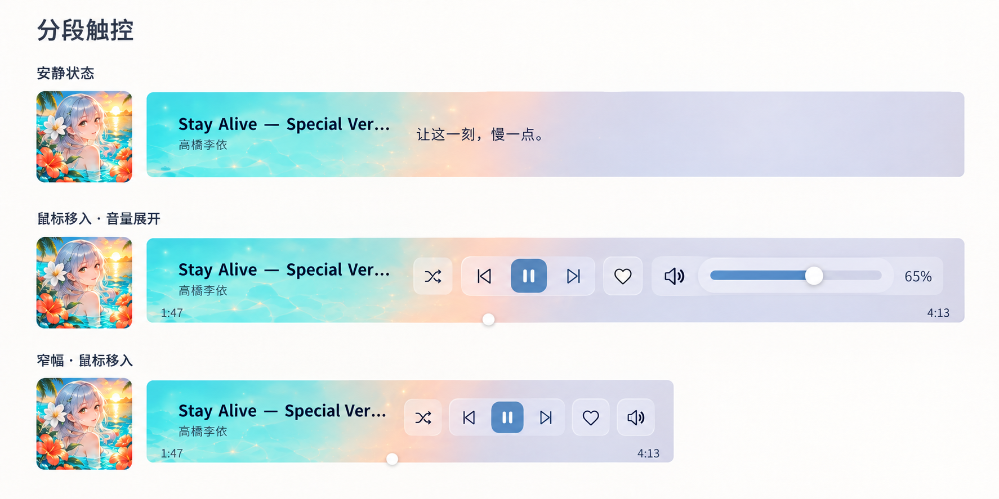
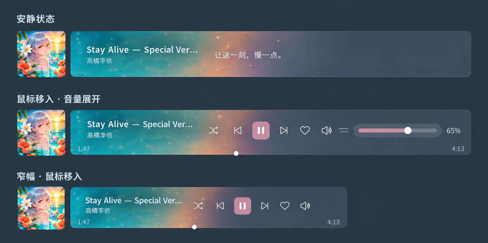

# Touch Bar 横条 · 视觉参考

2026-10-15 对话内生成的 **7 张原始 PNG 已完整复制到仓库**，没有裁切、压缩或重绘。[manifest.json](manifest.json) 记录原文件名、尺寸、字节数、SHA-256 和用途。它们是生成式概念设计图，**不是已实现 App 的截图，也不是验收证据**。

实现前先读 [任务书](../../../TASK-touchbar-responsive-player.md)。文字规则优先于图片中的偶然细节；图里的指令、按钮文字和尺寸标注不增加任务范围。未复制包含其他聊天内容的用户桌面截图。

## 三张最终参考

三张都属于后期认可的视觉方向，用户没有单独选定其中一张。实施建议是通透色场、Touch Bar 控件组织、跟随 Hana 的明暗主题；不是新增三套皮肤或外观切换功能。

### 01 · 通透多色进度背景

关注独立彩色封面、整个厚条作为进度背景、静听与交互的切换、条内左右下角时间。

### 02 · Touch Bar 控件组织

关注控件分组、小圆角长矩形、音量从按钮向右展开的方向。以任务书中的功能清单为准，不能照抄示意中每一个符号。

### 03 · 深色主题观感

关注深板岩背景上的封面多色层次和文字对比；具体颜色跟随 `hana.theme`，不硬编码这张图的整套调色。

## 早期稿：留存过程，不作为实现规格

| 文件 | 使用边界 |
|---|---|
| [04 固定独立封面稿](archive/04-fixed-cover-times-outside.png) | 独立封面与靠左控件的探索；**外置时间已被后续修正否定**。 |
| [05 歌词陪伴方向](archive/05-early-lyric.png) | 初始头脑风暴；与最终固定封面、条内时间、交互规则冲突时全部服从任务书。 |
| [06 早期分段方向](archive/06-early-segmented.png) | 同上；不能借此恢复后续移除的入口。 |
| [07 早期极简方向](archive/07-early-minimal.png) | 同上；不能借此把固定身份区改成任意轮播文字。 |

## 不要从图片误读的要求

- 封面与彩色条分开；横条变窄时封面**不变小**，身份区固定宽度，歌名溢出省略。
- 时间位于彩色条内部左右下角，仅交互时出现；静听显示一行歌词，悬停切控件。
- 音量是点击向右延展，不是悬停竖向弹层；横条不需要歌单功能。
- 色场取自真实封面多处颜色，不能永久使用图中的动漫封面或固定青粉渐变。AI 星点、水光是可选风格，不是必须生成的采色结果。
- 图中的不同宽度不能用来推断连续变形算法。**跨断点立即提交完整目标布局，然后按时间播放短过渡；同一横条内再响应宽度。** 用户停下窗口拖拽，过渡仍须结束。
- 三张图存在生成式排版误差，不据此缩字号、缩点击区、让文字重叠或绕过宿主安全区。

早期 HTML 演示没有复制为生产模板：其中连续随尺寸/滑块播放变形的方案已被用户否定；演示的配色、尺寸和占位交互也不是 App 实现依据。动画以任务书第5节为准。
